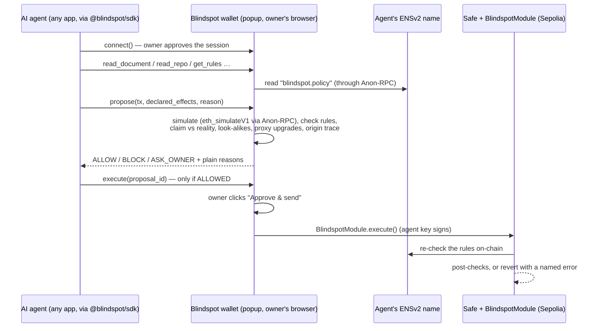

# Blindspot

**An agent wallet where an AI agent can be tricked — but cannot move money outside the owner's rules.**

AI agents that pay for things can be fooled by a poisoned invoice, a malicious web page, a booby-trapped
repository or a token whose name contains instructions. Blindspot accepts that the agent *will* be tricked
sometimes and makes sure that never turns into a loss:

- The owner's rules (who can be paid, how much per payment and per day, which contracts and functions) live on
  the **agent's ENSv2 name** — only the owner can change them.
- A **Safe module enforces those rules on-chain**. Even a stolen agent key cannot move money outside them.
- Before anything is signed, the **Blindspot wallet simulates every request privately through Anon-RPC**,
  compares what would really happen with what the agent claimed, traces suspicious values back to the
  untrusted text they came from, and answers **ALLOW**, **BLOCK** or **ASK OWNER** in plain language.
- Agents connect from the outside through **`@blindspot/sdk`**. They never see a key; they can only ask.

Built for ETHGlobal — targets: **Ethereum Foundation · Best CROPS App + Best Use of Anon-RPC** and
**ENS · Best Use of ENSv2**. Everything runs on **Sepolia**.

---

## Contents

1. [How it works](#how-it-works)
2. [Live on Sepolia](#live-on-sepolia)
3. [Quick start (run it locally)](#quick-start-run-it-locally)
4. [The SDK — connect your own agent](#the-sdk--connect-your-own-agent)
5. [The wallet](#the-wallet)
6. [The example agent](#the-example-agent)
7. [Rules (policy) reference](#rules-policy-reference)
8. [Security checks](#security-checks)
9. [Self-serve trial agents](#self-serve-trial-agents)
10. [Privacy and CROPS](#privacy-and-crops)
11. [Repository layout](#repository-layout)
12. [Environment variables](#environment-variables)
13. [Building and testing](#building-and-testing)
14. [Contracts and Sepolia scripts](#contracts-and-sepolia-scripts)
15. [Project status](#project-status)
16. [Honest limits](#honest-limits)
17. [Approved exceptions](#approved-exceptions)
18. [Troubleshooting](#troubleshooting)
19. [License](#license)

---

## How it works



**Three layers, each independent:**

| Layer | Where | What it guarantees |
| --- | --- | --- |
| **Rules on ENS** | the agent's ENSv2 subname, data record `blindspot.policy` | one source of truth, owner-only writes, revoke = unregister the name |
| **On-chain enforcement** | `BlindspotModule` on a Safe | allowed recipients / contracts / functions / tokens, per-tx and daily caps, max ETH, allowed spenders, no leftover approvals — even if the wallet is bypassed |
| **Wallet protection** | `apps/wallet` (popup, owner's browser) | private simulation, claim-vs-reality, look-alike and proxy-upgrade checks, origin trace, owner approval for every send |

**The agent key holds no funds.** Funds live in the Safe. The agent key's only path to them is
`BlindspotModule.execute()` / `executeBatch()`, which checks:

- the agent's ENSv2 name via `getState(labelhash)` — registered, `latestOwner == msg.sender`, not expired (token
  IDs are never cached);
- the owner's rules from the `blindspot.policy` record (missing or undecodable = revert);
- CALL only, never targeting the Safe or the module itself; code-hash pinning for non-proxy targets;
- after execution: caps, and no leftover approvals.

Violations revert with **named custom errors** (`RecipientNotAllowed`, `OutflowExceeded`, `DailyCapExceeded`,
`AgentNotActive`, `PolicyMissing`, `TargetNotAllowed`, `SelectorNotAllowed`, `SpenderNotAllowed`,
`CodeHashMismatch`, `AllowanceResidue`, `OperatorResidue`, `ApprovalResidue`, …), which the wallet translates
into plain language.

---

## Live on Sepolia

| What | Address |
| --- | --- |
| BlindspotModule ([verified](https://sepolia.etherscan.io/address/0x1bbeee9ea550755ae99566f7c2b6a9b381d4b874#code)) | `0x1BBeEe9eA550755Ae99566F7C2b6a9b381D4b874` |
| Safe v1.4.1 (1-of-1 owner) | `0x308924321a579844C0d7FA46Ea49dBec80a2a3F7` |
| Owner | `0x562044b9Cf72d267c7499Afc8aA5FD3Fcdf4E768` |
| Parent name | `blindspot-demo.eth` (expires 2027-11-05) |
| Agent | `demo.blindspot-demo.eth` → `0xab5437DcC26cFA763692Ab2e3e6Ee46D11Fc6DF1` |
| Agent registry (UserRegistry) | `0x6C4708DfF27c7e43CCa16467F65F041E8ba2a5Ce` |
| Agent resolver (PermissionedResolver) | `0xd8CB5CF0b1A80179Ca8B8d5540e9e12077408aB8` |
| Payees | `vendor1.blindspot-demo.eth` → `0x22dbbC1A9341064b3CA3e7c016D5cc22383dDe41`<br>`vendor2.blindspot-demo.eth` → `0xc7F3D37B90d2Ef6dBFD419B71354F74132c619B4` |
| Token used in the demo | official Sepolia MockUSDC `0x240b0316df57887dbbe58b586508b19e633a14aa` |
| TrialProvisioner (self-serve trials) | `0xB93A0C4663662BFCb4e31C75FF8E2D31D274b209` |
| Trial registry / resolver | `0xFDD39672df3578BC3c5A3AFee6290Bb58b2A7043` / `0xBa844a8658fF4aEA16B88D982523586b8BC3519b` |
| Trial Safe / trial module | `0x88CeAD43440a32F176ec184853CE51771165Db80` / `0x091960751C14Fd6399a0AE001fF8b0fBC32F392e` |

Every address — ENSv2 contracts (taken only from the
[official ENS deployments page](https://docs.ens.domains/learn/deployments)), Safe contracts (from
`safe-deployments` v1.4.1), Anon-RPC specifiers and pinned worker hashes, testbed contracts and every setup
transaction hash — is in **[`config/sepolia.json`](config/sepolia.json)**, the single config file the code reads.

**On-chain proof points** (all on Sepolia Etherscan):

| Event | Transaction |
| --- | --- |
| Agent pays vendor1 through the module | [`0x691588f6…08de`](https://sepolia.etherscan.io/tx/0x691588f6442e62396f9f83d80af55f3f17f2a5559398f78289a9a8d5c13a08de) |
| ALLOWED payment broadcast **through Nox (Anon-RPC)** | [`0x4fc3d68e…d6ba`](https://sepolia.etherscan.io/tx/0x4fc3d68e529db161f6c6da66db0da109e6f3760088fa93d67bac3b0c7bc2d6ba) |
| Direct bypass with the agent key → **reverted `RecipientNotAllowed`** | [`0x8a9afffa…c73a`](https://sepolia.etherscan.io/tx/0x8a9afffa81d72b2af496a421d8e7e1bde4d2432b60493ff765abe425cd49c73a) |
| Owner approves an ASK_OWNER payment via the Safe | [`0x79bc8f45…711a`](https://sepolia.etherscan.io/tx/0x79bc8f45ba50fff960c6b74f486d8a27a23468f1662a00562c49d96dafab711a) |
| Real-model agent run → ALLOW → owner Approve & send, through Nox | [`0x5a5bda5c…4e07`](https://sepolia.etherscan.io/tx/0x5a5bda5ca87337b18bc9acf64818d9da3b8a736c397633abb8b0c72e62fb4e07) |
| Owner changes the rules with one ENS `setData` (no redeploy) | [`0xdbd8c9fc…b2e9`](https://sepolia.etherscan.io/tx/0xdbd8c9fc23105662862a6e0d0d7f57ec6d829a0969715b6df8156343ad53b2e9) |

---

## Quick start (run it locally)

### Requirements

- **Node.js 20+** with **corepack** (pnpm `9.15.0` is pinned in `package.json`)
- **Git** (on Windows: Git Bash for the setup script)
- **[Foundry](https://getfoundry.sh)** — only for the contracts
- A **Sepolia RPC URL that supports `eth_simulateV1`**
- An **AI key** for the example agent — [Groq](https://console.groq.com) (free tier works), or any
  OpenAI-compatible endpoint, including a local one

### 1. Clone and install

```sh
git clone https://github.com/Vaibhav-Rawat-cipher/Blind-Agent.git blindspot
cd blindspot
sh scripts/setup-submodules.sh      # do NOT use --recurse-submodules (see Troubleshooting → Windows)
corepack pnpm install
corepack pnpm build                  # builds shared, sdk, core
```

### 2. Configure

```sh
cp .env.example .env
```

Fill in at least `SEPOLIA_RPC_URL`. See [Environment variables](#environment-variables) for the full list.
`.env` is git-ignored; never commit it.

### 3. Start the wallet and the agent (two terminals)

```sh
corepack pnpm --filter @blindspot/wallet serve     # wallet  → http://127.0.0.1:5181
corepack pnpm --filter @blindspot/agent serve      # agent   → http://127.0.0.1:5180
```

Optional, for self-serve trial accounts (third terminal):

```sh
corepack pnpm --filter @blindspot/relayer new-key  # once: creates TRIAL_RELAYER_PRIVATE_KEY (fund it with a little Sepolia ETH)
corepack pnpm --filter @blindspot/relayer serve    # relayer → http://127.0.0.1:8788
```

### 4. Use it

1. Open **http://127.0.0.1:5180** (the agent app).
2. **Unlock the AI** — a popup asks for your AI key once (it is encrypted with a password in your browser); on
   later visits it only asks for the password.
3. Type **“connect my wallet”**. The agent calls the SDK's `connect()`; the Blindspot wallet opens as a popup.
4. In the wallet, unlock (or choose **Try a free trial account** / **Just explore — simulate only**) and
   **Approve** the connection.
5. Give the agent a task, e.g. *“Pay this week's invoice from vendor1 (document invoice-0101)”*. Watch the
   wallet simulate and check it; click **Approve & send** if it is ALLOWED.
6. Try a trap, e.g. *“Pay this week's invoice (document invoice-0102)”* — an invoice with “new bank details”.
   The wallet BLOCKs it and shows the exact line that tried to redirect the money.

Press **Ctrl+Shift+D** in the agent app for presenter tools (preset tasks, technical details).

---

## The SDK — connect your own agent

`@blindspot/sdk` (in [`packages/sdk`](packages/sdk)) lets **any browser agent** use a Blindspot wallet. It has
**no dependencies and never handles a key**: it opens the wallet popup, asks the owner to approve a session, and
gives you OpenAI-compatible tool definitions plus a function to call them. Every tool runs **inside the
wallet** (reading tools too, so their output is traced as untrusted input).

### Installation

The SDK is not published to npm yet. Use it in one of these ways:

**Inside this monorepo** (any workspace package):

```jsonc
// package.json
"dependencies": { "@blindspot/sdk": "workspace:*" }
```

```sh
corepack pnpm install
```

**In any other project** (pack it as a tarball):

```sh
# in this repo
corepack pnpm --filter @blindspot/sdk build
cd packages/sdk && corepack pnpm pack        # → blindspot-sdk-0.0.0.tgz

# in your project
npm install /path/to/blindspot-sdk-0.0.0.tgz
```

It ships as an ES module with TypeScript types (`dist/index.js`, `dist/index.d.ts`) and runs in the browser
(it uses `window.open` and `postMessage`).

### Connect

```ts
import { connect, SessionRevokedError } from '@blindspot/sdk';

// Must run soon after a user click / key press: browsers only allow popups then.
const wallet = await connect({
  walletUrl: 'http://127.0.0.1:5181/',   // the Blindspot wallet (its origin is the only one the SDK listens to)
  agentName: 'My shopping agent',        // shown to the owner in the approval request (letters, digits, space . _ -; ≤ 64)
  features: 'popup,width=420,height=740' // optional popup window features
});

wallet.ensName;      // 'demo.blindspot-demo.eth' — the identity the agent acts as
wallet.agent;        // the agent's address
wallet.rules;        // the owner's current rules, read by the wallet at session start
wallet.rulesMessage(); // the same rules as a ready-made first message for your model
```

### Give the tools to your model

```ts
const tools = wallet.openAiTools(); // [{ type: 'function', function: { name, description, parameters } }, …]

const res = await fetch('https://api.groq.com/openai/v1/chat/completions', {
  method: 'POST',
  headers: { 'content-type': 'application/json', authorization: `Bearer ${AI_KEY}` },
  body: JSON.stringify({
    model: 'openai/gpt-oss-120b',
    temperature: 0,
    tools,
    messages: [
      { role: 'system', content: 'You manage a crypto wallet for its owner. Call get_rules before proposing any transaction.' },
      { role: 'user', content: wallet.rulesMessage() },
      { role: 'user', content: "Pay this week's invoice from vendor1 (document invoice-0101)" },
    ],
  }),
});
```

### Run the tool calls in the wallet

```ts
for (const call of choice.message.tool_calls ?? []) {
  try {
    const result = await wallet.callTool(call.function.name, JSON.parse(call.function.arguments || '{}'));
    messages.push({ role: 'tool', tool_call_id: call.id, content: result });
  } catch (e) {
    if (e instanceof SessionRevokedError) {
      // The owner revoked the session, locked the wallet or closed it: stop the agent.
      break;
    }
    messages.push({ role: 'tool', tool_call_id: call.id, content: JSON.stringify({ error: String(e) }) });
  }
}
```

### Session lifecycle

```ts
wallet.onEnded((reason) => console.log('session ended:', reason)); // 'revoked' | 'locked' | 'closed' | 'disconnected'
wallet.endedBy;      // null while active
wallet.disconnect(); // end it from the agent side
```

### Tools available over a session

| Tool | What it does |
| --- | --- |
| `get_rules` | the owner's rules for this agent, read from its ENS name (recipients shown with verified ENS names) |
| `get_balances` | the Safe's balances |
| `resolve_name` | ENS name → address (forward resolution) |
| `token_info` | a token's name, symbol, decimals (read on-chain; treated as untrusted text) |
| `read_document` | read an invoice / email / document — output is marked **untrusted** and traced |
| `read_repo` | read a code repository — **untrusted**, traced |
| `run_script` | run a repo script in a sandbox (no keys, no network) |
| `propose` | `{ actions, declared_effects, reason }` → simulated and checked → `ALLOW` / `BLOCK` / `ASK_OWNER` with reasons and a `proposal_id` |
| `execute` | `{ proposal_id }` — only for ALLOWED proposals, and only after the owner clicks **Approve & send** |

There is **no raw signing tool**. What the owner approves when connecting (shown verbatim in the wallet):
the agent **can** read rules, balances and names, read documents through the wallet, propose transactions and
execute ALLOWED proposals with the owner's approval; it **cannot** change the rules, sign anything itself, or
execute a BLOCKED / ASK_OWNER proposal.

### Letting the agent connect itself

The example agent exposes the connection as a tool, so the user simply says “connect my wallet”: before a
session exists the model only sees a `connect_wallet` tool; calling it runs `connect()`, and the wallet's tools
appear from the next step on. See [`apps/agent/src/main.ts`](apps/agent/src/main.ts) (`connect_wallet`,
`disconnect_wallet`).

### Protocol

Sessions run over `window.postMessage` between two origins, protocol id `blindspot-session/1`. Every message
is strictly validated on receipt (exact keys, id format, allowed tool names, argument size ≤ 64 KB); anything
malformed or from another origin is ignored. See [`packages/sdk/src/protocol.ts`](packages/sdk/src/protocol.ts).

> Browser agents only for now. Node / Python agents via an MCP server or bridge are on the roadmap.

---

## The wallet

[`apps/wallet`](apps/wallet) is the popup wallet the SDK opens (port **5181**).

- **Keys stay in the browser.** The agent key is pasted once and stored **encrypted with the owner's password**;
  when unlocked it lives in memory only. No key is ever sent anywhere. Locking or closing the wallet ends every
  session.
- **Three ways in:** unlock the demo agent (paste its key once), **Try a free trial account** (a fresh key made
  in your browser + a `tryN` name with tiny fixed rules, see [trials](#self-serve-trial-agents)), or **Just
  explore — simulate only** (no key; nothing is signed or sent).
- **Rules live from ENS**, described in plain language; presets, a rule editor and a plain-English helper (an
  LLM drafts, the owner reviews and signs).
- **Decision cards** for every proposal: verdict, every broken rule, and **“where it went wrong”** — the
  document / repo / page and the exact line a suspicious value came from.
- **Approve & send** for every transaction; **Sessions** list with **Disconnect** (revoke).
- **Anon-RPC (Nox)** for every read and broadcast, with pre-warm and retry states; a traffic meter shows what
  went through Anon-RPC and what was excluded.
- Reading tools and the `run_script` sandbox (an iframe with a no-network CSP) run here, not in the agent.

---

## The example agent

[`apps/agent`](apps/agent) (port **5180**) is an ordinary tool-calling LLM agent built with the SDK. It **holds
no wallet keys and no funds**.

- Models: **Groq `openai/gpt-oss-120b`** (default, temperature 0), `openai/gpt-oss-20b`, or any custom
  OpenAI-compatible endpoint (including local servers).
- The AI key is encrypted with a password in the browser; a popup asks for it when the AI is needed.
- Connects itself: say **“connect my wallet”** → `connect_wallet` → SDK `connect()`.
- Live log of every step in plain words; technical details (request ids, tokens, latency, raw replies) in
  presenter mode (**Ctrl+Shift+D** or `?dev`).
- Not made artificially gullible and no heavy anti-injection prompting: a normal, realistic agent.

---

## Rules (policy) reference

The owner's rules are an ABI-encoded struct stored in the agent's ENS data record **`blindspot.policy`**. The
TypeScript codec ([`packages/shared/src/policy.ts`](packages/shared/src/policy.ts)) is byte-identical to the
Solidity one ([`contracts/src/PolicyCodec.sol`](contracts/src/PolicyCodec.sol)).

| Field | Meaning | Enforced |
| --- | --- | --- |
| `version` | policy format version | on-chain |
| `targets`, `codeHashes` | contracts the agent may call; code hash pinned for non-proxy targets (`0x00…` = proxy) | on-chain |
| `selectors` | allowed function selectors per target | on-chain |
| `payees` | allowed recipients | on-chain |
| `spenders`, `operators` | allowed approval spenders / NFT operators (and no leftover approvals after a call) | on-chain |
| `tokens`, `tokenKinds` | tokens the agent may move, and their kind (ERC-20 / 721 / 1155) | on-chain |
| `maxOut`, `dailyCap` | per-transaction and per-UTC-day outflow cap, per token | on-chain |
| `maxEth` | max ETH out per transaction | on-chain |
| `rateLimitPerHour` | max proposals per hour | wallet only |
| `askOwnerAbove` | amounts above this go to the owner (ASK_OWNER) | wallet only |
| `blockNewContracts` | block contracts the wallet has not seen before | wallet only |

**Changing the rules** = one `setData` on the agent's resolver by the owner — no redeploy; the module reads the
new rules on the next call. **Revoking the agent** = unregistering its ENS name; the module then reverts with
`AgentNotActive`. The agent itself may only write `agent.status`; the owner also writes an ENSIP-26
`agent-context` record.

---

## Security checks

What the wallet checks for every `propose`, before anything is signed
([`packages/core/src/check/checks.ts`](packages/core/src/check/checks.ts)):

1. **Agent active** — the ENS name is registered to this agent and not expired.
2. **Fail closed** — anything the simulator cannot classify is BLOCKed.
3. **Module preview** — the exact on-chain call is simulated; a revert means BLOCK with the named error.
4. **Rules** — a wallet mirror of the on-chain rules that lists *every* broken rule, not just the first.
5. **Claim vs reality** — the simulated effects must match the effects the agent declared.
6. **No leftover approvals.**
7. **Look-alike addresses** — same first 3 + last 3 hex characters as a known address, but different.
8. **Proxy upgrade** — EIP-1967 implementation slot compared with a stored baseline.
9. **Rate limit** (wallet-only rule).
10. **New contracts** (wallet-only rule).

Plus the **origin trace** ([`packages/core/src/trace`](packages/core/src/trace)): every value read from an
untrusted source (documents, repos, token names, pages) is recorded, and suspicious values in a proposal are
traced back to the exact source and line. Simulation uses **`eth_simulateV1`** through Anon-RPC
([`packages/core/src/simulate`](packages/core/src/simulate)).

**Verdicts:** `ALLOW` (can be executed after the owner's Approve & send) · `BLOCK` (never executed; reasons +
source) · `ASK_OWNER` (inside the on-chain rules but needs the owner, e.g. above `askOwnerAbove`).

---

## Self-serve trial agents

So anyone can try a *real* payment without our keys:

- Trial agents get names **`tryN.trials.blindspot-demo.eth`** in their **own registry** — the demo Safe is fully
  isolated (the trial module reads the trial registry only).
- The visitor's browser creates a **fresh agent key**; the
  [`TrialProvisioner`](contracts/src/TrialProvisioner.sol) registers the name with **zero roles** and a **24 h
  expiry**, writes a tiny fixed policy (**1 MockUSDC per tx, 2 per day, vendor1 / vendor2 only, no ETH out**) and
  drips a tiny amount of gas.
- Limits: **one trial per sender per day**, **global cap 100/day**, relayer quota inside that cap, owner **pause**
  (kill switch) and unregister.
- The **gas-only relayer** ([`apps/relayer`](apps/relayer)) can do exactly one thing — call
  `TrialProvisioner.provision(agent)` for a visitor whose new key has no gas. It never holds an agent key or Safe
  funds. Per-IP limit, kill switch `RELAYER_ENABLED=false`.
- Provisioner roles (checked on-chain): `ROLE_REGISTRAR` on the trial registry only, `ROLE_SET_DATA` for the key
  `blindspot.policy` on the trial resolver only — nothing on the demo registry.
- Fallback: **simulate only** mode.

---

## Privacy and CROPS

**Censorship-resistant · Open-source · Private · Secure.**

- **Private:** every wallet RPC read, simulation and broadcast goes through **Anon-RPC** —
  **Nox** on Sepolia (via `@anon-rpc/browser-harness@0.4.0`), with **tor-js** as the fallback network. The
  worker bundle is only started if its `keccak256` matches the hash pinned in
  [`config/sepolia.json`](config/sepolia.json) (see [Approved exceptions](#approved-exceptions)).
- **Keys stay on the device.** Agent key and AI key are encrypted in the browser; nothing secret is sent to a
  server. No trackers, no analytics services, no remote code (except the pinned Anon-RPC worker).
- **Open source:** MIT, everything in this repo.
- **Secure by construction:** the on-chain module enforces the rules even if the agent, the agent app or the
  wallet is compromised.

**Declared non-anonymized (excluded) traffic:**

| Traffic | Why |
| --- | --- |
| Bootstrap read of the Anon-RPC specifier contract (Sepolia RPC for Nox; mainnet RPC for tor-js) | needed to learn the worker hash before the anonymizing network exists |
| Owner setup scripts (Foundry) | owner-run deployment, direct RPC |
| `read_repo` → GitHub REST API | fetching public repository content |
| AI requests → the chosen AI provider (e.g. Groq) | the model runs at the provider; not RPC traffic |
| Trial relayer → Sepolia RPC (server side) | it sends the provisioning transaction |
| Hosted LLM proxy (public site, planned) | the only backend; rate-limited; not used in presenter mode |

---

## Repository layout

| Path | Contents |
| --- | --- |
| `contracts/src/BlindspotModule.sol` | Safe module: ENS identity + rules, `execute` / `executeBatch` (≤ 8 calls), post-checks, named errors |
| `contracts/src/PolicyCodec.sol` | on-chain policy struct, decoding and validation |
| `contracts/src/TrialProvisioner.sol` | self-serve trial agents (registration, tiny policy, gas drip, caps, pause) |
| `contracts/src/demo/` | attack / demo contracts (inject token, pool, honeypot, evil vault, upgradeable target) used in tests and the testbed |
| `contracts/test/`, `contracts/test/fork/` | unit, batch, NFT, ENS-permission, attack and trial tests; fork tests against the live deployment |
| `contracts/script/` | Sepolia setup as Foundry scripts (`Setup*`, `SetupFinal`, `SetupTestbed`, `SetupTrials`, `UpdateDemoPolicy`, rules-key and relayer scripts) |
| `contracts/broadcast/` | Foundry broadcast records of the real Sepolia deployments |
| `config/sepolia.json` | **all** addresses, pinned hashes and setup transactions |
| `packages/shared` | policy codec (byte-identical to Solidity), plain-language errors, effect / proposal / trace types |
| `packages/core` | rules engine, ENS reader, simulation, checks, origin trace, agent loop, session host, analytics — browser-agnostic, everything platform-specific goes through adapters (`storage`, `rpc`, `llm`, `readSource`, `runScript`) |
| `packages/sdk` | **`@blindspot/sdk`** — `connect()`, tool definitions, `callTool()`, `SessionRevokedError` |
| `apps/wallet` | the popup wallet |
| `apps/agent` | the example agent built with the SDK |
| `apps/relayer` | gas-only relayer for trial agents |
| `checks/r1-anon-rpc` | browser check: `eth_blockNumber` + `eth_simulateV1` through Nox / tor-js |
| `checks/r3-llm` | LLM check + local proxy (the only code that reads `LLM_API_KEY`) |
| `checks/e2e-milestone` | end-to-end milestone on live Sepolia through Nox |
| `scripts/setup` | TypeScript dry-run of the whole setup in one `eth_simulateV1` request (sends nothing) |
| `scripts/setup-submodules.sh` | dependency setup that works on Windows |

---

## Environment variables

Copy `.env.example` to `.env`. Only what you use is needed.

| Variable | Used by | Purpose |
| --- | --- | --- |
| `SEPOLIA_RPC_URL` | wallet, scripts, fork tests, relayer | Sepolia RPC; **must support `eth_simulateV1`**. The wallet uses it as the Nox target and for the declared bootstrap read |
| `MAINNET_BOOTSTRAP_RPC_URL` | wallet | mainnet RPC for the tor-js fallback's specifier read only (fallback disabled if empty) |
| `OWNER_PRIVATE_KEY` | Foundry setup scripts | owner / deployer key — local only |
| `AGENT_PRIVATE_KEY` | fork / live tests | demo agent key — local only, never published |
| `ETHERSCAN_API_KEY` | `forge verify-contract` | contract verification |
| `LLM_API_KEY` | `checks/r3-llm` proxy | AI provider key for the proxy (the example agent instead asks in the browser) |
| `TRIAL_RELAYER_PRIVATE_KEY` | `apps/relayer` | gas-only relayer key (`pnpm --filter @blindspot/relayer new-key`) |
| `RELAYER_ENABLED` | `apps/relayer` | kill switch (default `true`) |
| `RELAYER_PER_IP_DAILY` | `apps/relayer` | trials per IP per day (default `2`) |
| `RELAYER_ALLOWED_ORIGIN` | `apps/relayer` | allowed browser origin (default: the local wallet) |
| `R1_*`, `E2E_SEPOLIA_RPC` | `checks/*` | overrides for the check pages |

---

## Building and testing

```sh
corepack pnpm build                                   # all TypeScript packages
corepack pnpm test                                    # all unit tests (live tests skip without .env)
corepack pnpm --filter @blindspot/agent typecheck
corepack pnpm --filter @blindspot/wallet typecheck

cd contracts
forge build
forge test                                            # unit, batch, NFT, ENS-permission, attack, trial tests
forge test --match-path "test/fork/*"                 # fork tests against the live Sepolia deployment (needs .env)
```

Recorded results (details in [`docs/PROGRESS.md`](docs/PROGRESS.md)):

| Suite | Result |
| --- | --- |
| Solidity unit / batch / NFT / ENS-permission / attack / trial tests | 103 pass (mutation checks: 10 / 10 caught) |
| Solidity fork tests against the live deployment | 19 pass |
| `packages/core` (incl. live tests) | 200 / 200 |
| `packages/shared` | 21 / 21 |
| Session + SDK | 27 pass; 5 / 5 session-protection mutations caught |
| End-to-end milestone on live Sepolia through Nox | PASS (ALLOW sent, BLOCK with source, bypass reverted, ASK_OWNER, owner approval) |
| Anon-RPC R1 (Nox): `eth_simulateV1` through Nox == direct, byte for byte | PASS |

Check pages (local only, never deployed):

```sh
corepack pnpm --filter @blindspot/check-r1-anon-rpc serve        # Anon-RPC check
corepack pnpm --filter @blindspot/check-e2e-milestone serve      # end-to-end milestone
node checks/r3-llm/proxy.mjs & node checks/r3-llm/check.mjs      # LLM check
```

---

## Contracts and Sepolia scripts

Keys are read inside the scripts with `vm.env*` from the local `.env`; nothing secret goes on the command line.
From Windows PowerShell:

```powershell
cd contracts
$env:Path += ";$env:USERPROFILE\.foundry\bin"
Get-Content ..\.env | ForEach-Object { if ($_ -match '^\s*([A-Z0-9_]+)\s*=(.*)$') { Set-Item "env:$($matches[1])" $matches[2].Trim().Trim('"',"'") } }
forge script script/Setup.s.sol:SetupA --rpc-url sepolia            # dry run (add --broadcast --slow to send)
forge test --match-path "test/fork/*"                               # fork tests against the live deployment
```

- ENS registration uses commit-reveal: **Script B must run between 60 seconds and 24 hours after Script A's
  commit.** The parent `.eth` name is paid in the official Sepolia MockUSDC.
- Each agent is a subname in our own `UserRegistry` (deployed via `VerifiableFactory` + `setSubregistry`),
  registered to the agent address with **zero roles** and an absolute expiry, with its own
  `PermissionedResolver`; `blindspot.policy` is owner-only; the agent may write only `agent.status`.
- The whole setup can be dry-run in one `eth_simulateV1` request:
  `corepack pnpm --filter @blindspot/setup dry-run` (sends nothing).
- ENS contracts are pinned to `ensdomains/contracts-v2@07e55a056f5b6a9c90119f501bdd05714e67dddd`, the commit the
  Sepolia ENSv2 deployment links to.

---

## Project status

| Step | Status |
| --- | --- |
| 1 · Contracts + ENS setup on Sepolia | ✅ deployed, verified, tested |
| 2 · `packages/core` (simulation, checks, trace, agent loop, rules editor, analytics) | ✅ done, milestone passed on live Sepolia |
| 3a · Agent / wallet separation + `@blindspot/sdk` + popup wallet | ✅ done |
| 3d · Self-serve trial agents | 🟡 contracts deployed + tested; wallet / relayer flow in progress |
| 3c · Public site (Try-it mode + view mode, “Verify it yourself”, recorded-run replay) | ⏳ planned |
| 4 · Browser extension | optional, only if time remains |
| 5 · Demo world, analytics recap, video | ⏳ in progress (teammate) |

**Roadmap:** hosted deployment (wallet and agent on separate origins, hosted rate-limited LLM proxy), Node /
Python agents via MCP or a bridge, npm release of `@blindspot/sdk`.

---

## Honest limits

- **Inside-the-rules decisions are not prevented.** If the owner allowlists a contract, a call within the caps
  succeeds on-chain even if the contract is a scam (`test_honestLimit_evilVaultInsideRules_notCaughtOnChain`).
  Only the wallet's claim-vs-reality check can flag it; the loss is bounded by `maxOut` / `dailyCap`.
- **ERC-1155 amounts are not tracked on-chain.** For an ERC-1155 token the policy must set
  `maxOut = dailyCap = 0`, meaning “amount not tracked”, not “nothing can move”
  (`test_honestLimit_erc1155AmountNotTracked`). Recipients, operators, targets and functions are still enforced.
- **Proxy upgrades are not detected on-chain.** Proxy targets (code hash `0x00…`) are covered by the wallet's
  off-chain EIP-1967 check; on-chain, the caps and no-leftover-approval rules bound the damage
  (`test_attack_upgradedProxy`).
- **Wallet-only rules** (rate limit, look-alike / new-contract blocks, ask-owner threshold) do not protect
  against a stolen agent key.
- **If the wallet is bypassed**, hidden effects, unknown events and upgraded proxies on owner-allowed contracts
  are caught only by the wallet's off-chain checks; the module accepts them when they stay inside the rules
  (proven on the Sepolia testbed).
- **Anon-RPC availability:** Nox can briefly have no exit (`NoTunnelExitError`); the wallet waits and retries,
  and shows the state.
- **Determinism:** temperature 0 is best-effort at the provider.

---

## Approved exceptions

- **Anon-RPC worker bundle (owner decision 2026-11-06).** `@anon-rpc/browser-harness` downloads the
  anonymizing network's worker bundle at runtime and runs it in a Web Worker inside a null-origin sandboxed
  iframe, only if its `keccak256` equals the hash in the network's on-chain specifier. This is an approved
  exception to “no remote code”. Blindspot additionally pins the expected hash per network in
  `config/sepolia.json` and refuses to start if the on-chain hash differs. The specifier read itself is declared
  excluded traffic.

---

## Troubleshooting

**Windows: submodule checkout fails** with `invalid path 'scripts/hardhat/deploy:mainnet.ts'` — the nested
`contracts/lib/nexus` submodule of `ensdomains/contracts-v2` has a file name with `:`, which Windows does not
allow. Blindspot does not use nexus. Run `sh scripts/setup-submodules.sh` (Git Bash) instead of
`--recurse-submodules`; it initialises only the libraries in `contracts/remappings.txt`, non-recursively, and
passes `core.longpaths=true` (otherwise deep paths fail with `Filename too long`). Or keep the repo in a short
path such as `C:\src\blindspot`.

**`Port 5180/5181 is already in use`** — the app is already running; reload the browser tab. To restart
(PowerShell):
`Get-NetTCPConnection -LocalPort 5180,5181 -State Listen | ForEach-Object { Stop-Process -Id $_.OwningProcess -Force }`

**The wallet popup does not open** — allow pop-ups for `127.0.0.1:5180`. If the AI took too long to decide, the
chat shows an **Open wallet to connect** button; click it.

**“The wallet window was closed before you approved”** — keep the wallet popup open until you have unlocked
it and clicked **Approve**.

**AI errors:** `HTTP 401` = wrong AI key (remove it in the AI popup and paste it again); `HTTP 429` = the Groq
free tier's per-minute token limit — wait a minute.

**`SEPOLIA_RPC_URL is missing in .env`** — copy `.env.example` to `.env` and set it. The RPC must support
`eth_simulateV1`.

---

## License

MIT — see [LICENSE](LICENSE).
